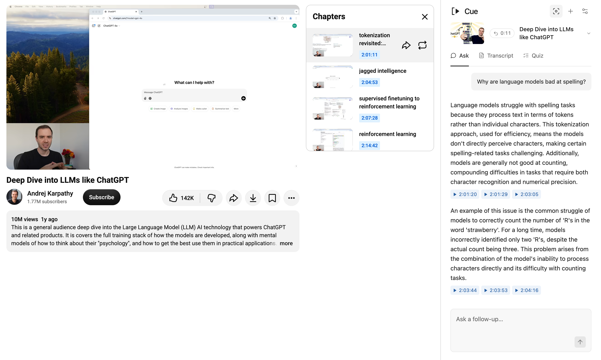
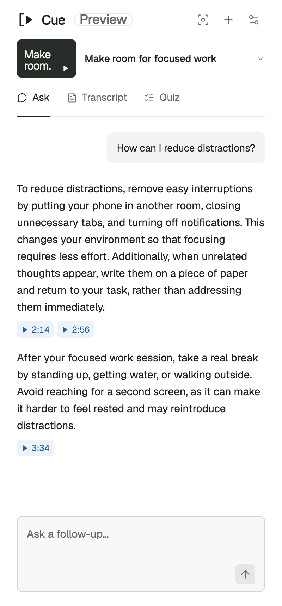
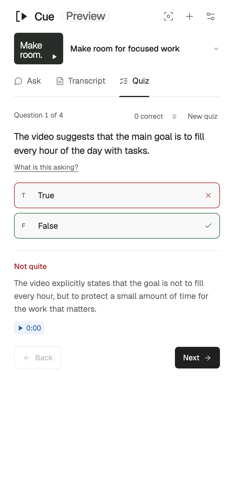
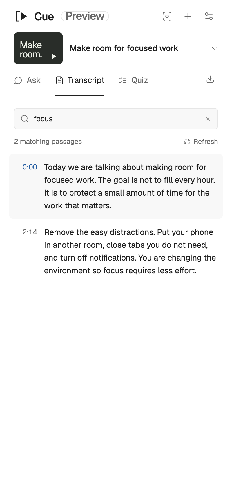

# Cue

Ask a YouTube video a question and get an answer that cites the moments it came from. Click a
timestamp and the video jumps there. Cue can also quiz you on what you watched, and every quiz
question links back to the passage that settles it.

Cue is a Chrome side panel plus a small Node service that runs on your machine. Answers come from
a local Ollama model or from DeepInfra, whichever you pick. There is no account and no cloud
database. Transcripts are cached on your disk, and conversations stay in the browser session.



<table>
  <tr>
    <td></td>
    <td></td>
    <td></td>
  </tr>
  <tr>
    <td align="center">Ask</td>
    <td align="center">Quiz</td>
    <td align="center">Transcript</td>
  </tr>
</table>

## What it does

- **Ask.** Answers are split into parts, and each part carries the timestamps it rests on.
  Clicking one seeks the player. Follow-up questions keep the conversation.
- **Quiz.** Four question types (multiple choice, true or false, a short answer of a few words,
  and a paragraph marked against a rubric) at four difficulties: easy, medium, hard, and S tier.
  Star a question you found interesting and ask for a deeper round on just those passages.
- **Transcript.** The full transcript, searchable, with every row clickable. Download it as text.
- **Return chip.** Every jump you make, from Cue or from YouTube's own scrubber or chapter list,
  leaves a `↩ 6:07` chip that takes you back to where you were.
- **Focus mode.** Hides recommendations, comments, the masthead, shelves and end screens, leaving
  the player, the title and the panel.
- **Your choice of model.** The settings list every model Ollama has installed plus a DeepInfra
  model. With a local model selected, nothing leaves your computer.

## The interesting parts

Most "chat with a video" tools paste the transcript into a prompt and trust what comes back. Cue
spends most of its code checking the model's work. These are the parts worth reading.

### Timestamps never come from the model

The model sees transcript segments with ids and replies with ids. The server rejects any id that
was not in the context it sent, then looks up the time and the quoted text itself. A model can
pick the wrong passage, but it cannot make up a timestamp. Small local models that invent ids get
"Try a larger model" instead of a broken answer.

### Rare words decide what a long video sends

A short transcript (under 24 KB) goes to the model whole. A three-hour lecture does not fit, so
`selectContext` spreads a sample across the whole video and adds passages that match your
question, weighted by how rare each word is (IDF), plus their neighbours. Plain term counting
filled the budget with "what", "does" and "mean" and missed the one word that mattered.

### Quizzes are seeded, so no two are alike

Each quiz request gets a six-character seed. The seed shuffles a list of reader lenses ("a
sceptical viewer", "an engineer debugging this") and question angles ("what would break it",
"which assumption it rests on") into the prompt. With temperature 0.8 and a list of questions to
avoid, two runs on the same video measured 15 unique prompts out of 15. The seed is logged under
`CUE_DEBUG_QUIZ`, so a quiz you liked can be reproduced.

### Every quiz question must quote its evidence

The generator returns a verbatim quote of up to 120 characters for each question. The server
looks for that quote in the cited segment. If it finds the quote in a different segment, it moves
the citation there. If it finds it nowhere, the question is dropped.

This rule exists because of a real failure. On a 3.5-hour video, the generator saw 346 of 5,761
segments, found no link between tokenization and arithmetic in its sample, and wrote a question
saying there was none. The video says there is. A quote has to exist for a claim to ship, because
a gap in a sample proves nothing.

### A second model checks that the quote answers the question

A quote that exists can still be beside the point. After validation, one batched call with Qwen's
thinking turned on reads the passage around each citation and drops any question the passage
cannot settle. For paragraph questions it also checks each rubric point against a verbatim quote
found in that passage, and drops the question if fewer than two points survive. Thinking matters
here: with it off, Qwen3-32B kept invented points and threw out real ones.

The generator is asked for two more questions than you requested, because these guards drop some.
If the quiz still comes up short, the summary says so. It is never padded with questions the
transcript can't back.

### Questions test understanding, not recall

For medium and above, the server rejects a question that quotes its own passage, asks what
something is called, or asks for a number. It also drops near-duplicates. The prompt asks why,
what follows, how two ideas compare, and how one applies somewhere new. S tier has its own angles:
counterfactuals, quantitative consequences, the strongest objection, a case the video never shows.

### Written answers are graded by a model that reads the transcript

A paragraph can't be checked by string matching. The grader gets the question, the reference
answer, the rubric, your words, and about two minutes of transcript around the citation. It is
told the transcript is the authority and the reference answer may be wrong. It accepts loose
phrasing, typos and synonyms, and returns a one-line reason that appears under the verdict.

If the grading call fails, Cue shows the error and a "Try again" button. It never records a wrong
answer for a dropped request. There is also no "I was right" override, so the score means you
answered correctly.

### "What is this asking?" can't leak the answer

The clarifier rephrases a confusing question and says what shape of answer it wants. It is given
the question, its type and the passage, and never the answer, the accepted variants or the
rubric.

### Captions come from the tab you already have open

Cue first reads captions inside your YouTube tab. It captures the player's own caption requests,
or opens YouTube's transcript panel, reads the rows, and closes it again. YouTube makes those
requests with the session it already has, so no cookies leave the browser. Long transcripts are
virtualised, so a scrape is trusted only if it reaches about 90% of the video's length. If the tab
can't help, the local service tries `yt-dlp` and then `ytdl-core`. Results are cached on disk for
seven days, and a stale copy is served at once while a fresh one downloads.

### Errors say what actually went wrong

A timeout, a dropped connection and a stopped service all look the same to `fetch`. When a
request fails, the panel checks `/api/health` before writing the message, so it can tell you
whether to wait, retry, or run `npm start`. Model replies are parsed tolerantly: fences and
preamble are stripped, truncated JSON keeps the parts that finished, and an unparseable reply is
retried once before the error names the model and quotes what it said.

## Setup

You need Node 22 or newer, Chrome 120 or newer, and one of these:

- [Ollama](https://ollama.com) with a model pulled, for example `ollama pull qwen3:8b`. Pick
  something that fits your memory; a 4 to 6 GB model is comfortable on 16 GB of RAM.
- A [DeepInfra](https://deepinfra.com) API key.

```bash
git clone https://github.com/<you>/cue.git
```

```bash
npm install
```

```bash
npm run install:ytdlp
```

```bash
cp .env.example .env.local
```

Add your DeepInfra key to `.env.local` if you're using one. Then build and start the service:

```bash
npm run build
```

```bash
npm start
```

The service listens on `http://127.0.0.1:4317`. Open that address to try the panel on a built-in
sample video before installing anything.

To install the extension, open `chrome://extensions`, turn on Developer mode, click
"Load unpacked" and choose `outputs/extension`. Open any YouTube video and click the Cue icon.

The first build writes a random token to `.cue-token` and bakes it into the extension. The service
only answers requests that carry it, and it refuses other origins. Your API key stays in
`.env.local` and never reaches the browser.

## Configuration

Everything is optional and lives in `.env.local`. See [`.env.example`](.env.example).

| Variable | What it does |
| --- | --- |
| `DEEPINFRA_API_KEY` | Enables the DeepInfra model in the picker. |
| `DEEPINFRA_MODEL` | Which DeepInfra model. Default `Qwen/Qwen3-32B`. |
| `OLLAMA_URL` | Where Ollama listens. Default `http://127.0.0.1:11434`. |
| `CUE_COOKIES_FROM` | Lets `yt-dlp` use a browser's YouTube cookies (`chrome`, `safari`, `firefox`, `edge`, `brave`, `chromium`). |
| `CUE_COOKIES_FILE` | A `cookies.txt` file for `yt-dlp` instead. |
| `CUE_DEBUG_QUIZ` | Logs quiz seeds, rejected questions and audit results. |

If `yt-dlp` returns an empty file or `400 Precondition check failed`, YouTube is refusing an
anonymous client, usually after a lot of traffic. Setting `CUE_COOKIES_FROM` fixes it.

## Development

```bash
npm run check          # TypeScript, must be clean
npm test               # unit tests: parsing, retrieval, providers, cache
npm run qa:preview     # Playwright against the preview on :4317
npm run qa:extension   # Playwright against real YouTube with the extension loaded
npm run screenshots    # regenerate the images in docs/screenshots
```

Rebuild after changing anything in `src/`, and restart the service after changing `server/`. The
preview serves the built extension, not the source.

[`AGENTS.md`](AGENTS.md) is the detailed design record: why each rule exists, what broke before
it, and the testing gotchas (Chrome for Testing paths, `--load-extension` in branded Chrome, and
so on). Read it before changing retrieval, quiz generation or grading.

```
src/panel/       React side panel
src/extension/   content script, page-world script, service worker
src/shared/      transcript parsing and shared types
server/          local API: answers, quiz, grading, clarifying, transcripts, cache
scripts/         build, yt-dlp installer, screenshots
tests/           unit tests and Playwright QA
```

## Contributing

Issues and pull requests are welcome. See [CONTRIBUTING.md](CONTRIBUTING.md).

## License

[MIT](LICENSE)
